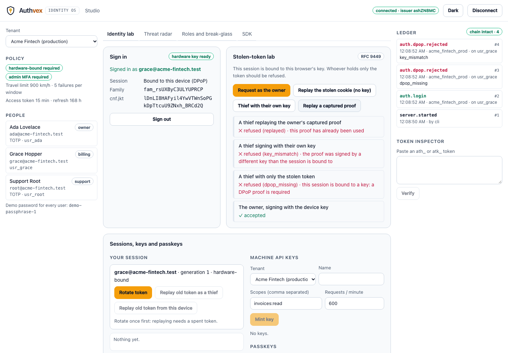
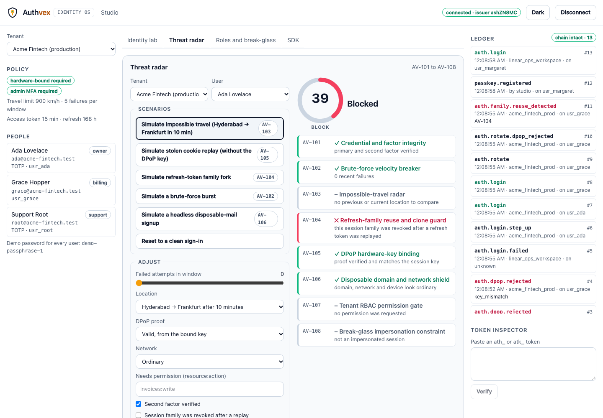
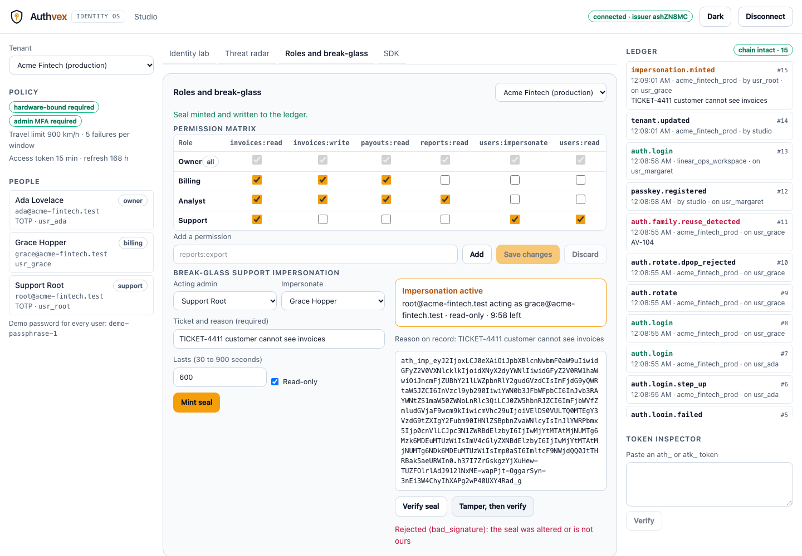
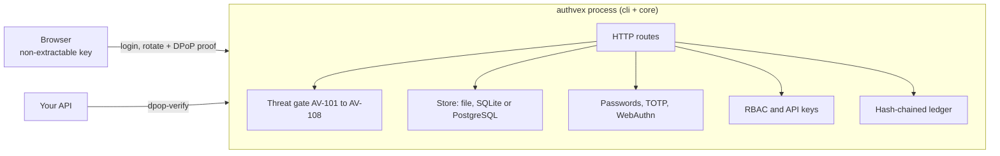

<div align="center">


# Authvex

**Make stolen session tokens worthless. Self-hosted identity with hardware-bound sessions, passkeys and zero-trust checks.**

Passkeys, TOTP, RBAC and audit, written from the specifications on Web Crypto alone: no `jsonwebtoken`, no `bcrypt`, no `otplib`, no `simplewebauthn`. One small server, one embeddable React kit.

[](https://github.com/isagarpinninti/authvex/actions/workflows/ci.yml)
[](https://www.npmjs.com/package/@authvex/cli)
[](https://www.npmjs.com/package/@authvex/core)
[](https://www.npmjs.com/package/@authvex/react)
[](package.json)
[](LICENSE)

[Quickstart](#quickstart) · [Guide](docs/GUIDE.md) · [Documentation](#documentation) · [Security](#security) · [Limits](#limits-read-before-adopting)

</div>

```bash
npx @authvex/cli init && npx @authvex/cli studio
```

<p align="center">
  
</p>

## Contents

- [Overview](#overview)
- [Capabilities](#capabilities)
- [How it compares](#how-it-compares)
- [Quickstart](#quickstart)
- [Using Authvex](#using-authvex)
- [Architecture](#architecture)
- [Security](#security)
- [Quality and verification](#quality-and-verification)
- [Performance](#performance)
- [Limits: read before adopting](#limits-read-before-adopting)
- [Documentation](#documentation)
- [Development](#development)
- [Support, contributing, license](#support-contributing-license)

## Overview

A normal session token is a bearer token: whoever holds it *is* the user. When one leaks (a browser extension, an XSS bug, a log line, a compromised proxy), the attacker signs in as them from anywhere, until it expires. Refresh tokens last for days.

Authvex changes the economics. A session is **bound to a key that never leaves the browser**: each request carries a fresh proof signed by it (RFC 9449 DPoP), so the token alone is worth nothing. Refresh tokens are single-use, and the first replay of an old one **revokes the whole session family**. Around that sit passkeys, TOTP, per-tenant RBAC, a threat gate that scores every sign-in (including impossible travel), scoped machine keys, sealed break-glass impersonation, and a hash-chained audit ledger.

It is a self-hosted alternative to the *session and authorization core* of services like Clerk, Auth0 and Kinde, with no per-user pricing and no third party in the loop. It is **not** a drop-in replacement for the whole product: see [Limits](#limits-read-before-adopting).

**Good fit:** products that must keep identity on their own infrastructure, security-sensitive apps (fintech, admin tools, internal platforms) that want sessions that survive token theft, teams that want to read and test their auth layer.

**Not a fit (yet):** social login, SAML or OIDC federation (Authvex is an OIDC *provider*, not a client of others), SMS delivery, a hosted multi-tenant SaaS with compliance attestations.

## Capabilities

| | |
| --- | --- |
| **Hardware-bound sessions (RFC 9449)** | Sessions carry `cnf.jkt`, the thumbprint of a non-extractable ECDSA P-256 key. Requests need a proof signed by that exact key, for that method and URL, for that token, once. Stolen token, stolen cookie, or a thief's own valid-looking proof: all refused, each with its own reason |
| **Refresh-family kill-switch** | Tokens rotate `gen 1 → 2 → 3`, stored only as hashes. Replaying a spent token revokes the whole family at once (`AV-104`), including the legitimate session |
| **Threat gate AV-101 to AV-108** | Credentials and MFA, brute-force velocity, Haversine impossible travel, family reuse and passkey clones, DPoP binding, disposable domains and datacenter networks, RBAC, break-glass rules. A 0 to 100 trust score and an allow, step-up or block decision, with every check explained |
| **Passkeys without a library** | Parses the raw WebAuthn `authenticatorData` and COSE keys, converts DER signatures, checks RP id, origin, challenge, UP and UV flags, and the signature counter (cloned-authenticator detection), then verifies ECDSA P-256 |
| **TOTP and passwords** | RFC 6238 TOTP checked against the RFC test vectors, each code usable once; PBKDF2-HMAC-SHA-256 (210,000 iterations) with constant-time comparison, and the same hashing work for "no such user" as for "wrong password" |
| **Multi-tenant RBAC** | Tenants with their own policy and roles; `resource:action` permissions with wildcards; a visual role matrix that saves straight to the server |
| **Machine API keys** | `atk_live_…` keys with scopes, per-minute rate limits and expiry. Only a hash is stored; the key is shown once |
| **Break-glass impersonation** | `ath_imp_…` seals naming the acting admin, the user, the reason, and an expiry of at most 15 minutes. Altered seals fail verification; every mint and refusal is in the ledger |
| **Sessions that survive restarts** | A `Store` holds session families, the DPoP replay cache, failure windows, challenges and TOTP counters: in a file (default), in SQLite (shareable between processes, with compare-and-set so two servers agree on which refresh token was used first), or in memory. Parallel use of one refresh token lets exactly one request win |
| **Issuer key rotation and JWKS** | Rotate the signing key with `authvex issuer rotate`: the old key keeps verifying for an overlap so nobody is signed out, then lapses. Revoke a compromised key at once. Public keys are published at `/.well-known/jwks.json`, so your API can verify sessions offline across rotations |
| **Email flows** | Sign-up with confirmation, password reset and magic links over a built-in SMTP client. Same answer for known and unknown addresses, a mail budget per address, single-use hashed tokens carried in the URL fragment |
| **OpenID Connect provider** | Per-tenant code flow with mandatory PKCE, ES256 ID tokens, refresh, DPoP, end-session and a hosted sign-in page. Validated by an independent client library |
| **Passkey attestation** | `packed` and `fido-u2f` verified against root certificates you supply, with a built-in X.509 reader; policy can require a trusted authenticator model |
| **Passkey-only accounts** | Sign up without a password, create a passkey from the emailed link, manage your own passkeys (changes need a device-bound session or your password) |
| **Shared state** | The `postgres` store lets several servers on several hosts share sessions, with atomic single-statement operations |
| **Memory-hard hashing** | Optional `scrypt` or `argon2id` with automatic upgrade at next sign-in |
| **KMS/HSM signing** | The issuer key can live behind an `ExternalSigner`; the private half never enters the process |
| **API middleware** | `createGuard` with Express, Fastify, Hono and fetch-handler (Next.js) adapters: local JWKS check, or introspection that sees revocation at once |
| **Operations** | Prometheus metrics, JSON logs, `authvex doctor`, Dockerfile |
| **Audit ledger** | Hash-chained log of every security event. `authvex ledger verify` finds an edited, removed or reordered entry. No secret ever reaches it |
| **Studio** | A three-pane console: tenants and people, an identity lab with a stolen-token simulator, the threat radar, the RBAC matrix, the live ledger and a token inspector. WCAG 2.1 AA checked in light and dark |

<p align="center">
  
  
</p>

## How it compares

An honest comparison; it is not a claim that Authvex is better for every job.

| | Authvex | Hosted (Clerk, Auth0, Kinde) | DIY with JWT libraries |
| --- | --- | --- | --- |
| Hosting | Your process | Their cloud | Your code |
| Pricing | None | Per active user | None |
| Stolen-token resistance | Key-bound sessions, single-use refresh with reuse detection | Bearer tokens (some offer rotation) | Whatever you build |
| Passkeys, TOTP, RBAC, audit | Built in | Built in | You build them |
| Hosted sign-in page, OIDC provider, email flows | Yes (basic) | Yes | You build them |
| Social login, SAML, SMS, SSO federation | **No** | Yes | You build them |
| Auditable by reading | Small codebase, RFC-tested | Closed | Yours |
| Horizontal scale | Yes, with the Postgres store (untested at large scale) | Managed | You build it |
| Operational burden | You run it | None | You run it |

## Quickstart

**Requirements:** Node.js 20 or newer.

```bash
mkdir identity && cd identity
npx @authvex/cli init       # config, three demo tenants, five demo users, issuer key
npx @authvex/cli validate   # check everything; warnings tell you what is not yet production-safe
npx @authvex/cli studio     # server on 127.0.0.1:4320, prints a Studio link, the JWKS address and where state is kept
```

Open the link it prints on **`http://localhost:4320`** (use `localhost` rather than `127.0.0.1` if you want to try a real passkey). Sign in as `grace@acme-fintech.test` with `demo-passphrase-1`; the session is bound to your browser's key. Then open the **Stolen-token lab** and try to use it as a thief.

The complete walkthrough, from protecting an API route to deployment and troubleshooting, is **[docs/GUIDE.md](docs/GUIDE.md)**.

## Using Authvex

### Embed the sign-in card

```bash
npm install @authvex/react zod
```

```tsx
import "@authvex/react/styles.css";
import { ZeroTrustLoginCard } from "@authvex/react";

export function SignIn() {
  return (
    <ZeroTrustLoginCard
      baseUrl="https://id.example.com"
      tenantId="acme_fintech_prod"
      onSession={(s) => keepInMemory(s.sessionToken, s.refreshToken, s.deviceKey)}
    />
  );
}
```

### Protect an API route

Your API receives the session token and a `DPoP` header. One call decides whether they belong together and whether the user may do this:

```bash
curl -X POST https://id.example.com/api/auth/dpop-verify -H 'content-type: application/json' -d '{
  "sessionToken": "ath_sess_…", "dpopProof": "<DPoP header value>",
  "method": "GET", "url": "https://api.example.com/v1/invoices", "requirePermission": "invoices:read" }'
# 200 { "valid": true, "bound": true, "claims": { "sub": "usr_grace", "tid": "acme_fintech_prod", … } }
# 401 { "valid": false, "reason": "dpop_missing" | "key_mismatch" | "replayed" | "session_revoked" | … }
```

Or verify locally, with no network call, on Node, an edge runtime or a worker:

```ts
import { DpopReplayCache, verifyDpopSessionRequest } from "@authvex/core";

const replay = new DpopReplayCache();
const r = await verifyDpopSessionRequest({
  sessionToken, dpopProof: req.headers.get("dpop") ?? undefined, method: req.method, url: req.url,
  issuerPublicKeyJwk: ISSUER_PUBLIC_JWK, replayCache: replay, requireBinding: true,
});
if (!r.ok) return new Response(r.message, { status: 401 }); // r.reason is a stable code
```

### Protect an API with middleware

```ts
import express from "express";
import { createGuard, expressGuard } from "@authvex/core";

const guard = createGuard({ issuer: "https://id.example.com", baseUrl: "https://api.example.com", requireBinding: true });
const app = express();
app.use("/api", expressGuard(guard)); // req.authvex holds the claims
```

`fastifyGuard`, `honoGuard` and `withAuthvex` (Next.js route handlers, Workers) work the same way. `mode: "introspect"` asks the server each time, so a revoked session stops at once and `permission` is enforced. See [docs/MIDDLEWARE.md](docs/MIDDLEWARE.md).

### Packages and commands

| Package | Role |
| --- | --- |
| [`@authvex/core`](packages/core) | The engine: passwords, TOTP, WebAuthn, DPoP, refresh families, threat gate, RBAC, API keys, impersonation seals. Web Crypto only; runs in Node, edge runtimes and browsers |
| [`@authvex/react`](packages/react) | `ZeroTrustLoginCard` plus the operator tools `ThreatRadarWorkbench`, `ActiveSessionsAndPasskeysPanel`, `TenantRbacAndImpersonationStudio` |
| [`@authvex/cli`](packages/cli) | The `authvex` command: server, REST API, ledger and bundled Studio |

| Command | Purpose |
| --- | --- |
| `authvex init [dir]` / `validate [dir]` | Scaffold and check a workspace |
| `authvex studio` (`start`) | Run the server, API and Studio |
| `authvex evaluate <tenant> […]` | Run the AV-101..108 gate on a scenario (exit 2 on step-up or block) |
| `authvex key mint\|list\|revoke` | Machine API keys |
| `authvex impersonate --actor … --target … --reason "…"` | Sealed support impersonation |
| `authvex issuer list\|rotate\|revoke\|prune` | Rotate the signing key, retire or revoke one |
| `authvex ledger verify\|list` | Check or read the audit ledger |
| `authvex token verify <token>` | Verify any `ath_` or `atk_` token |
| `authvex doctor [--strict] [--offline]` | Check a workspace before going live (exit 1 on a failure) |
| `authvex oidc client add\|list\|remove\|rotate-secret` | Manage OpenID Connect clients |
| `authvex mail test <address>` | Send a test email |

Exit codes: `0` success, `1` a check failed, `2` bad usage (for `evaluate`: step-up or blocked).

## Architecture



`@authvex/core` is pure functions on Web Crypto, with no I/O, so every behaviour is tested without a server and the same code runs in a browser, a worker or Node. Every verifier returns a result with a stable reason code. Details: [docs/ARCHITECTURE.md](docs/ARCHITECTURE.md).

## Security

- Sessions bound to a client key; proofs bound to method, URL, token and a one-time id; single-use refresh tokens with reuse detection.
- Passkeys verified against RP id, origin, challenge, flags and counter; TOTP codes work once; passwords hashed with PBKDF2, scrypt or Argon2id and compared in constant time.
- Refresh tokens and API keys stored only as SHA-256 hashes; the ledger never holds a secret.
- Binds to `127.0.0.1` by default; admin API behind a bearer token with no cookies; the Studio's token travels in the URL fragment and never reaches a server.
- Uniform responses (and the same hashing work) for unknown user, wrong password and wrong tenant; throttling per address and per account.

You are responsible for TLS (use a reverse proxy and set `publicUrl`), `rpId` and `origins`, protecting `.authvex/` and `users.json`, and providing location data only from an edge you control. The [security model](docs/SECURITY_MODEL.md) spells out the threats, what each defence does *not* cover, and what is not implemented. Report vulnerabilities privately: [SECURITY.md](SECURITY.md).

## Quality and verification

Everything below runs in CI on every push and before every release.

| Check | Scope |
| --- | --- |
| Unit and property tests | `@authvex/core` (also under Zod 3 and 4): HOTP and TOTP against the RFC 4226 and 6238 vectors, Base32 against RFC 4648, CBOR against RFC 8949 examples, WebAuthn parsing fuzzed so it only ever throws its own error type, DPoP attacks (stolen token, thief's key, replay, wrong method or URL, stale proof), refresh-family property tests |
| Integration | The REST API on real HTTP: enumeration resistance, brute force, step-up, passkey cloning, impersonation tampering, key scopes and rate limits, ledger tamper detection; the React components against a real server |
| End-to-end | Playwright drives the real server and Studio, including a **real WebAuthn passkey** through Chromium's virtual authenticator |
| Accessibility | axe (WCAG 2.0 and 2.1, A and AA) on every Studio view in light and dark; no serious or critical violations allowed; no sideways scroll at 375 px |
| Smoke test | Packs the three packages, installs them in a clean project, and drives the installed CLI and API, including a bound login, a stolen-token refusal and the family kill-switch |
| Model-based invariants | Random scripts of logins, rotations, spent-token replays, revocations, clock jumps, restarts and key rotations run against the real server over HTTP (file and SQLite stores), checked against an independent model. Planting a bug in the revocation, the family check, the key overlap or the proof-key check makes it fail within a few steps, and fast-check shrinks the script to show why |
| Static checks | `tsc --noEmit` in strict mode with `noUncheckedIndexedAccess`; ESLint with `no-explicit-any` and `no-eval` as errors |
| Fuzzing | Random and mutated input to every parser and verifier (CBOR, authenticator data, X.509, tokens, JWT, DPoP) and to every HTTP route; nothing may throw unexpectedly or answer 5xx |
| Stores | One contract suite across memory, file, SQLite and PostgreSQL, including parallel races |
| Interoperability | `openid-client` against the OIDC provider; real Express, Fastify and Hono behind the guard; OpenSSL's output for scrypt, Argon2id and certificate chains |
| Browsers | Chromium and WebKit end to end; Firefox in CI (not verified locally) |
| Supply chain | Pinned Action SHAs, SBOMs, `npm audit` on runtime dependencies |
| Node versions | 20, 22 and 24 (only 24 verified locally) |

## Performance

`npm run bench` times the cryptographic hot paths on Web Crypto. On a developer laptop (Node 24) a bound request verifies (session signature plus DPoP proof) in about 0.3 ms (roughly 3,600 per second), a passkey assertion in about 0.16 ms, a refresh rotation in under 0.05 ms and the eight-check threat gate in well under a microsecond; a PBKDF2 password check takes about 23 ms, slow on purpose. These are single-core, in-process figures, not a capacity guarantee: your hardware and traffic will differ. CI enforces generous budgets to catch regressions of around 10x.

## Limits: read before adopting

- **Not independently audited.** The maintainers wrote and tested it; no outside firm has reviewed it. See the [threat model](docs/THREAT_MODEL.md) for what is claimed and what nobody has checked.
- **Scale is unproven.** The Postgres store allows several hosts, but it has only been exercised on one machine. `npm run load` gives you numbers for yours; the published ones are from a laptop.
- **Users and tenants are files.** `users.json` and `tenants/*.json`, rewritten atomically. That suits hundreds of users, not millions, and several servers must share those files.
- **OIDC provider only.** No social login, no SAML, no enterprise SSO federation, no SMS. Email delivery is a basic SMTP client.
- **Passkey attestation:** `none`, `packed` and `fido-u2f` only; ES256 (P-256) only; no revocation checking. Never tried with real hardware from every vendor.
- **Location is yours to provide.** There is no GeoIP database; `AV-103` runs only if your edge supplies coordinates (`trustGeoHeaders`).
- **TLS is yours.** The server speaks plain HTTP; terminate TLS in a reverse proxy and set `publicUrl`.
- **A non-extractable browser key is not an HSM.** DPoP stops theft and replay from another machine, not malware driving the original browser.
- **Signing keys are a file by default.** Use an `ExternalSigner` (programmatic API) for a KMS or HSM; the CLI itself only reads the file keyring.
- **Local middleware checks cannot see revocation** until the access token expires; use introspection mode when that matters.
- **The Dockerfile and Firefox job are untested** by the maintainers; so are Windows and real devices.
- **The ledger is tamper-evident, not tamper-proof.**
- **Pre-1.0.** The API may change between minor versions; see the [changelog](CHANGELOG.md).

## Documentation

| | |
| --- | --- |
| [Guide](docs/GUIDE.md) | Workspace, bound sessions, attacking your own session, protecting a route, passkeys, threat radar, break-glass, deployment, troubleshooting |
| [Hardware-bound sessions and DPoP](docs/CRYPTO_DPOP_SPEC.md) | Token formats, every verification step and its reason code, refresh families, what it does not stop |
| [Passkeys, TOTP and passwords](docs/WEBAUTHN_AND_TOTP.md) | The binary formats, the checks, clone detection, registration, RP settings |
| [Tenants, RBAC, keys, break-glass, the gate, the CLI and the API](docs/B2B_RBAC_AND_CLI.md) | Config, every gate and threshold, REST reference, ledger |
| [React components](docs/REACT.md) | The four components, device key helpers, accessibility |
| [Architecture](docs/ARCHITECTURE.md) | Packages, a login's path, design decisions |
| [Security model](docs/SECURITY_MODEL.md) | Threats, defences, assumptions, what is not implemented |
| [Threat model](docs/THREAT_MODEL.md) | Assets, boundaries, adversaries, residual risk, what the tests cover |
| [Email and sign-up](docs/EMAIL_AND_SIGNUP.md) | Mail drivers, sign-up, reset, magic links, passkey-only accounts, self-service passkeys |
| [OpenID Connect](docs/OIDC.md) | Clients, endpoints, flows, claims |
| [Protecting your API](docs/MIDDLEWARE.md) | The guard and the Express, Fastify, Hono and fetch adapters |
| [Operations](docs/OPERATIONS.md) | Stores, Docker, metrics, logs, doctor, hashing, KMS, load testing |
| [Device testing](docs/DEVICE_TESTING.md) | Browser matrix and the manual real-device procedure |

## Development

```bash
git clone https://github.com/isagarpinninti/authvex.git && cd authvex
npm install
npm run build        # core, react, Studio (static export), then CLI
npm test             # core (also Zod 3), react, cli
npm run e2e          # Playwright + axe on Chromium (run `npx playwright install chromium` once); e2e:webkit, e2e:firefox
npm run interop      # third-party clients and frameworks against the server
npm run load         # load and soak test
npm run smoke        # pack, install in a clean project, drive the CLI and API
npm run bench        # cryptographic hot-path budgets
npm run gates        # everything above, in order
```

Repository layout: `packages/core`, `packages/cli`, `packages/react`, `src/` (the Studio), `e2e/`, `scripts/`, `docs/`, `examples/demo`.

## Support, contributing, license

- Questions and bugs: [SUPPORT.md](SUPPORT.md). Security: [SECURITY.md](SECURITY.md).
- Contributions are welcome: [CONTRIBUTING.md](CONTRIBUTING.md) and the [code of conduct](CODE_OF_CONDUCT.md).
- Release history: [CHANGELOG.md](CHANGELOG.md).
- [MIT](LICENSE) © Sagar Pinninti
